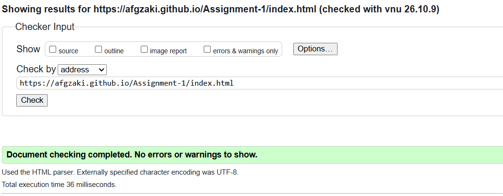
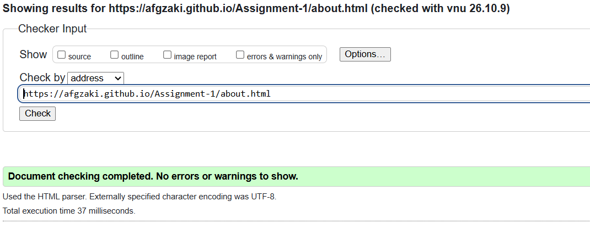
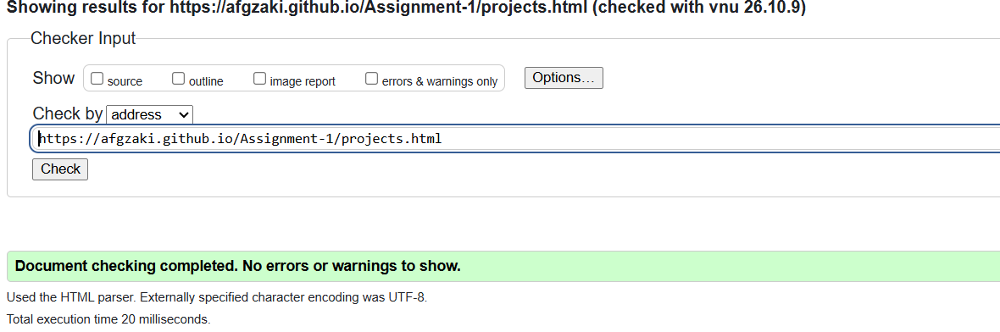
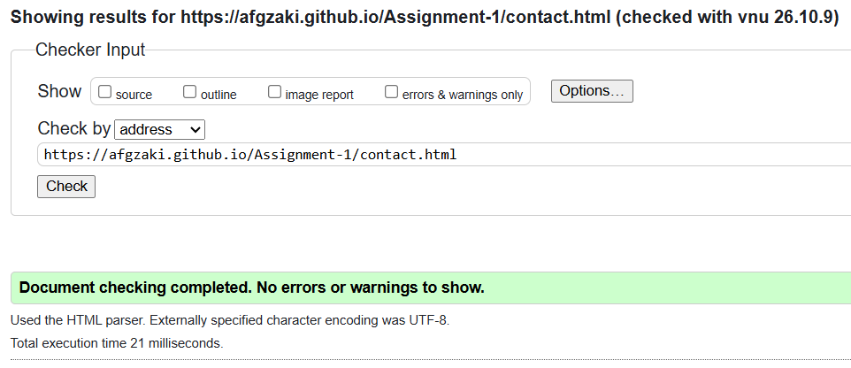
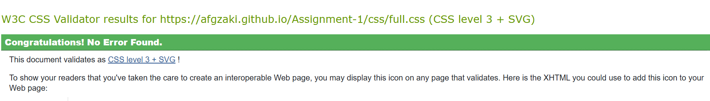
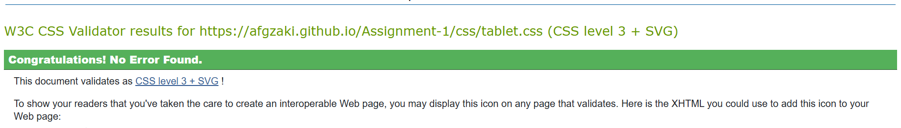
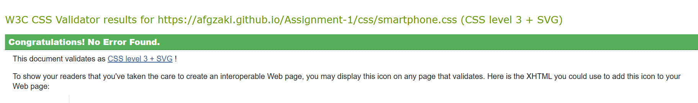
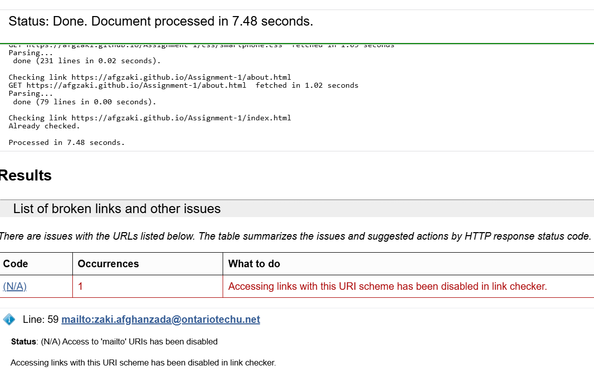
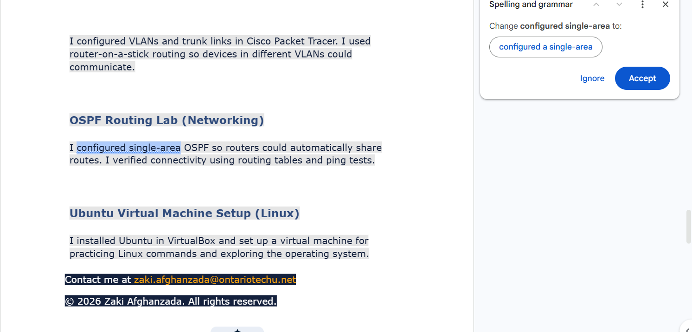
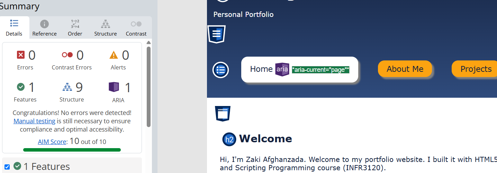

# INFR3120 Assignment 1 - Personal Portfolio Site

**Student:** Zaki Afghanzada
**Course:** INFR3120 - Web and Scripting Programming (Fall 2026)
**Live site:** https://afgzaki.github.io/Assignment-1/
**Repository:** https://github.com/afgzaki/Assignment-1

## Pages
- `index.html` - Home
- `about.html` - About Me (photo, introduction, video)
- `projects.html` - Projects
- `contact.html` - Contact Me (form with validation)

## Color scheme
Created with Adobe Color (https://color.adobe.com/create) using the **Complementary** rule.

| Role | Hex | Used for |
|---|---|---|
| Navy | `#14213D` | Header, footer, main text |
| Blue | `#2F4B7C` | Gradient end colour, secondary panels |
| Amber | `#FCA311` | Accent, buttons, link hover |
| Gold | `#FFD27A` | Light end of the angled gradient |
| Light gray | `#E5E5E5` | Page background |

Navy and amber sit roughly opposite each other on the colour wheel, which is why the
scheme is complementary. All text/background pairs used on the site were checked
against the WCAG AA contrast ratio (4.5:1) so the pages pass WAVE contrast checks.

## Viewport sizes (separate CSS file for each)

| Device | Width | File |
|---|---|---|
| Laptop | 960px and wider | `css/full.css` |
| Tablet | 481px to 959px | `css/tablet.css` |
| Smartphone | 480px and narrower | `css/smartphone.css` |

I used these breakpoints because they are the ones from the Week 3 lecture's responsive template (`responsive.html`). Each page links all three stylesheets, and the `media` attribute on each `<link>` tag tells the browser which one to apply. The layout is fluid: widths are set in percentages, so the content stretches to fit within each range. 

## Gradients

 - **Linear gradient:** the header (`#banner`) on all four pages goes from navy to blue, top to bottom. It is in each of the three CSS files.
 - **Angled linear gradient:** the `.hero` box ("Explore the site") on the Home page goes from amber to gold at 135deg.

## Testing and validation

| Test | Result | Screenshot |
|---|---|---|
| W3C HTML validator, index.html | No errors |  |
| W3C HTML validator, about.html | No errors |  |
| W3C HTML validator, projects.html | No errors |  |
| W3C HTML validator, contact.html | No errors |  |
| W3C CSS validator, full.css | No errors |  |
| W3C CSS validator, tablet.css | No errors |  |
| W3C CSS validator, smartphone.css | No errors |  |
| W3C link checker | Only the mailto: link was not checked |  |
| Spell check (Google Docs) | One typo found in projects.html and fixed |  |
| WAVE, all four pages | 0 errors, 0 contrast errors |  |

**Notes**
- The link checker cannot test `mailto:` links by design, so it reports that one as disabled. The email link works in a browser.
- WAVE shows one alert on the About page. It is the standard reminder that appears whenever a page contains a `<video>` element, asking the developer to check manually that the video is accessible. The video has playback controls and a poster image. I did not add captions or a transcript because the assignment did not require them and captions need extra markup outside the lecture material.
- The contact form uses a `mailto:` action, so Chrome may show a "not secure" autofill notice on the form fields. The assignment does not require a server, and the form validation (required fields, email format, 10-digit phone number) works.

## Code sources
## Code sources and AI disclosure

Most of the code is adapted from the INFR3120 lecture material (Weeks 1-4): the three-stylesheet responsive layout, semantic page structure, floats and percentage widths, the form, the video element, and the hover transform and transition.

A small number of features go beyond the lectures. I estimate they make up less than 10% of the code. Each is documented with a reference.

| Feature | Reference |
|---|---|
| `box-sizing: border-box` | [MDN box-sizing](https://developer.mozilla.org/en-US/docs/Web/CSS/box-sizing) |
| `aria-current` on the current nav link | [W3C WAI-ARIA 1.2](https://www.w3.org/TR/wai-aria-1.2/#aria-current) |
| Attribute selectors such as `a[aria-current]` and `input[type=...]` | [MDN attribute selectors](https://developer.mozilla.org/en-US/docs/Web/CSS/Attribute_selectors) |
| `pattern` on the phone field | [MDN pattern](https://developer.mozilla.org/en-US/docs/Web/HTML/Attributes/pattern) |
| `minlength` on the name field | [MDN minlength](https://developer.mozilla.org/en-US/docs/Web/HTML/Attributes/minlength) |
| `type="tel"` | [MDN input tel](https://developer.mozilla.org/en-US/docs/Web/HTML/Element/input/tel) |
| `max-width` on the wrapper | [MDN max-width](https://developer.mozilla.org/en-US/docs/Web/CSS/max-width) |
| `list-style-type` | [MDN list-style-type](https://developer.mozilla.org/en-US/docs/Web/CSS/list-style-type) |
| `vertical-align` | [MDN vertical-align](https://developer.mozilla.org/en-US/docs/Web/CSS/vertical-align) |
| `border-left` | [MDN border-left](https://developer.mozilla.org/en-US/docs/Web/CSS/border-left) |
| `linear-gradient()` with a 135deg angle | [MDN linear-gradient](https://developer.mozilla.org/en-US/docs/Web/CSS/gradient/linear-gradient) |

### AI assistance
I used AI during this assignment to review the HTML and CSS based on the INFR3120 lecture code when it would give me an error, and to troubleshoot VS Code, Git and GitHub Pages problems. 
